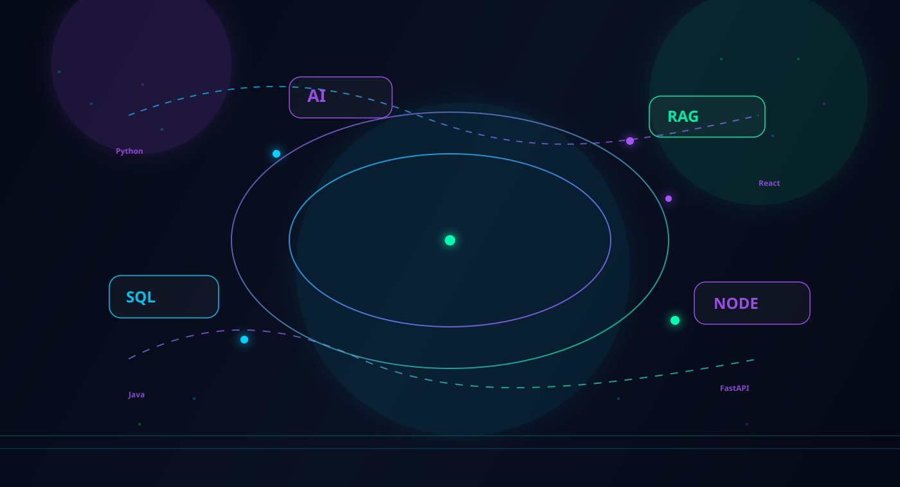

<!--
  Arvinth S.N. | GitHub Profile
  Focus: backend engineering, applied AI, data systems
-->

  

  

<h1 align="center">Arvinth S.N.</h1>

  <strong>Software Engineer · Backend & Applied AI</strong> 
  Designing APIs, data pipelines, and AI-powered systems.

  <a href="https://github.com/ArvinthSN">GitHub</a> ·
  <a href="https://www.linkedin.com/in/arvinth-s-n/">LinkedIn</a> ·
  <a href="mailto:arvinthsn.dev@gmail.com">Email</a>

  
  
  

---

## Profile

I'm a software engineer interested in the engineering behind reliable products: API design, backend services, data workflows, and practical AI applications. I enjoy taking a problem from requirements and system design through implementation, integration, and iteration.

Currently sharpening my backend engineering foundations with **Java, Spring Boot, REST APIs, persistence, and system design**, while continuing to build with **Python, FastAPI, retrieval-augmented generation, and data tooling**.

- **Engineering interests:** backend architecture, distributed systems fundamentals, applied AI, data engineering
- **Working style:** specification-first development, clean interfaces, measurable behavior, and iterative delivery
- **Based in:** India

## Engineering toolkit

  

| Area | Technologies |
|---|---|
| Languages | Java, Python, SQL, C, JavaScript |
| Backend & APIs | Spring Boot, FastAPI, Node.js, REST, JPA |
| Frontend | React, Tailwind CSS |
| Data & persistence | PostgreSQL, MongoDB, Supabase, Pandas, NumPy |
| AI & retrieval | LLM applications, RAG, LangChain, embeddings, pgvector, Qdrant |
| Analytics | Power BI, Tableau, Matplotlib |
| Engineering tools | Git, GitHub, Docker, Linux, n8n, Apache Airflow (fundamentals) |

## Selected engineering work

### SYNOVA — Motor insurance workflow platform
**Applied AI · Backend APIs · Retrieval · Automation**

A prototype insurance aggregation and workflow platform focused on simplifying motor insurance journeys.

- Built backend CRUD workflows and integrated a local PostgreSQL data store.
- Worked on a retrieval-augmented assistant for insurance-domain questions.
- Explored document understanding and workflow automation for renewal and form entry.
- Designed around a React client, FastAPI services, PostgreSQL, and insurer integrations.

**Stack:** React · FastAPI · PostgreSQL · pgvector · LangChain · OCR · LLM APIs

### AI Call Center Analytics
**Speech processing · NLP · Classification**

A pipeline concept for turning multilingual call recordings into structured operational insights.

- Worked on Tamil/Hindi transcription and downstream text classification.
- Focused on extracting call intent and making unstructured conversations easier to analyze.
- Project work has included an evaluation target/result of 87% intent accuracy across 1,000+ calls; measurement depends on the dataset and evaluation split.

**Stack:** Python · Speech-to-text · NLP · Classification · Analytics

### Global LLM Market Analytics
**ETL · Data analysis · Visualization**

An analytics workflow exploring the model ecosystem using public Hugging Face model metadata.

- Collected model metadata for comparative analysis.
- Organized records into an analytics-ready dataset.
- Explored trends and presented findings through dashboards.

**Stack:** Python · Pandas · PostgreSQL · Power BI · Hugging Face

> Project descriptions summarize development work and prototypes. Individual integrations, metrics, and deployment status should be read in the context of each project's repository and documentation.

## Current learning

- Java and Spring Boot: IoC, dependency injection, beans, JPA, REST API design
- Backend design: validation, exception handling, transactions, authentication, caching
- System design: service boundaries, reliability, observability, and scalability
- AI systems: retrieval quality, evaluation, tool calling, and orchestration
- Delivery engineering: CI/CD workflows, containers, and infrastructure as code

## Highlights

- **Best Trainee Award** — SYNOVA project work
- **NPTEL Silver Medal** — Programming in Java
- **IIT Madras certificate** — Python for Data Science
- **NPTEL** — Programming in C
- **Datathon** — Third place
- **Industry exposure** — Data Analytics internship at NitroWare Technologies

## GitHub activity

  
  

  

  

## Connect

I'm interested in thoughtful engineering discussions, backend projects, applied AI, and collaborative product development.

  
  
  

  Build deliberately. Validate continuously. Ship useful software.

